# Holdout

**Offers only where they change the outcome.** A personalised-offer engine that doesn't pay people who'd buy anyway.

**Telegram bot:** [@navpreet_offers_bot](https://t.me/navpreet_offers_bot) · **Dashboard:** https://offer-engine-nu.vercel.app · **API:** https://offer-engine-n4jx.onrender.com/health

Most discount engines send 20% off to everyone and call the sales it "drove" a win. But many of those customers would have bought anyway. That is margin thrown away. **Holdout** is an analytics and agentic decisioning platform for e-commerce marketers. For each customer and moment it decides **whether** to make an offer, **which** offer and **when**, and delivers it through a Telegram bot. Marketers set the limits as plain-English rules. An AI agent (Groq) chooses and personalises the offer inside those limits. **Every AI choice is re-checked by the same deterministic rule code before it is sent**, and a rules fallback takes over whenever the AI is slow, wrong or over budget. Uplift scores, a 10% holdout group and "margin saved" reporting show that the money went where it changed behaviour.

*Why "Holdout"?* A holdout is the group that deliberately gets nothing, so you can measure what an offer really changed. Building the whole engine around that idea is what makes it different.

> Built for the Punjab Jobs AI Bootcamp (J-PAL South Asia) hackathon. All customer data is **synthetic**; no real or scraped personal data is used.

### Results so far (live, last 12 months of synthetic history plus live decisions)
| | |
|---|---|
| **+₹91,760** | incremental revenue vs the holdout, each campaign compared with its own control group |
| **₹14,916** | margin saved by *not* discounting customers who'd have bought anyway |
| **ROI by offer type** | flat ₹ off pays back 1.9×, 2× points are almost free, while blanket free shipping **lost ₹24,320**, because it mostly went to people who'd buy anyway. That is the case for targeting |
| **~2 s** | per AI decision (gpt-oss-120b, one call); about 25 ms when the rules fallback decides |

Numbers change as classmates use the bot; the dashboard's Experiments page always shows the current ones.

---

## Demo in 5 minutes

| # | Where | Do this | What you'll see |
|---|---|---|---|
| 1 | Telegram | Open [@navpreet_offers_bot](https://t.me/navpreet_offers_bot), send `/start`, answer 3 taps | A profile is built for you (persona plus 6 months of matching synthetic history) and a **welcome perk** arrives as an offer card |
| 2 | Telegram | `/simulate cart` | A cart-abandonment event goes through the full pipeline. You get a card with the exact value, expiry, a `monospace` coupon and 4 buttons |
| 3 | Telegram | Tap **❓ Why this?** (or `/why`) | Plain English: why you, why this offer, which offers were rejected and why, which rules were checked, and who decided (AI agent or rules fallback) |
| 4 | Telegram | `/simulate purchase`, then `/simulate cart` | **No offer.** The "no discount within 48 h of a purchase" rule blocks it, and the bot says so. The guardrails are visible |
| 5 | Customer Lab group | `/lab@navpreet_offers_bot run 3` | 3 synthetic customers (each voiced by a "Lab Shopper" bot) post activity. The Offer bot answers each one differently, because each persona has different rules. Some get **no offer on purpose** |
| 6 | Dashboard → Overview | Watch the live stream | Your decisions from steps 1–5 appear within seconds, tagged **AI agent** or **Rules fallback** |
| 7 | Dashboard → Playground | Pick a customer and trigger → Run | The **Decision Pipeline Lens**: Pre-gate → Policy → Agent → Validator → Sent, with every tool call and rule ✓/✗. Toggle "force LLM failure" to watch the fallback take over |
| 8 | Dashboard → Rules | Change "Deal hunters get at most **10%**" to 8% | An **impact preview** (customers affected, budget change) appears before you save; Save gives you version history and one-click revert |

A longer, timed walk-through for presenting is in [`docs/demo-script.md`](docs/demo-script.md).

### Screenshots (live data)
| | |
|---|---|
| 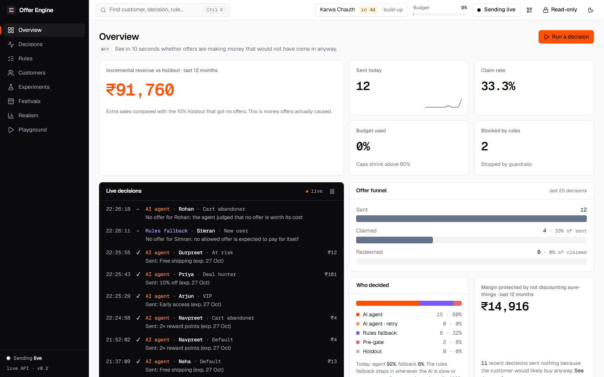 **Overview**: the one orange number is revenue offers actually caused, vs the holdout | 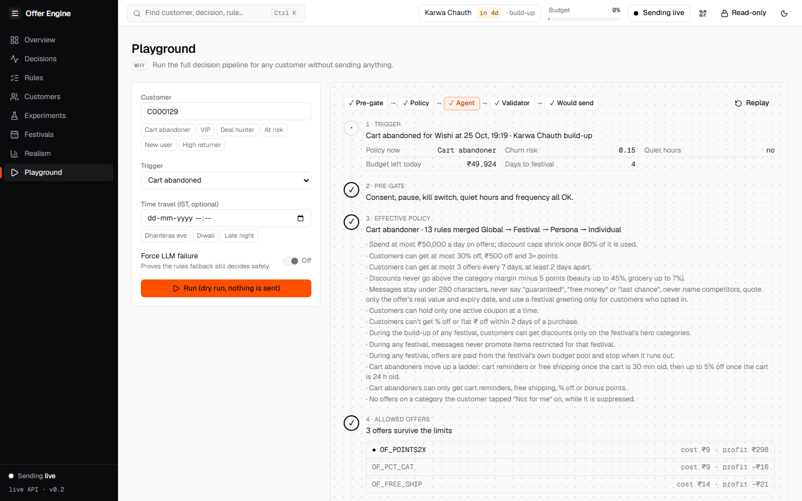 **Playground**: Pre-gate → Policy → Agent → Validator, every step explained |
| 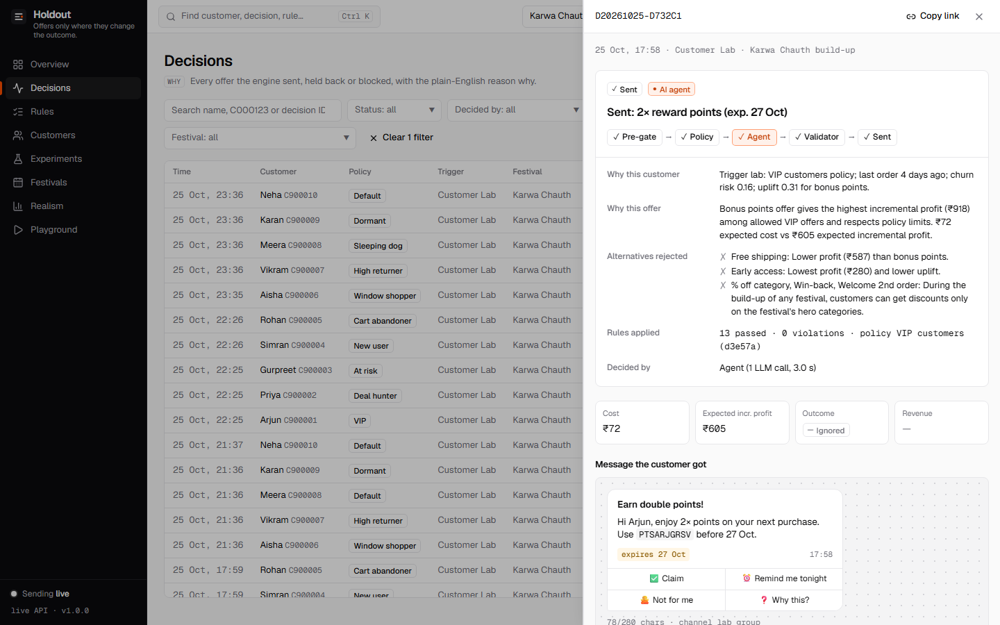 **Decision drawer**: explanation, rule ✓/✗, agent tool calls, card preview | 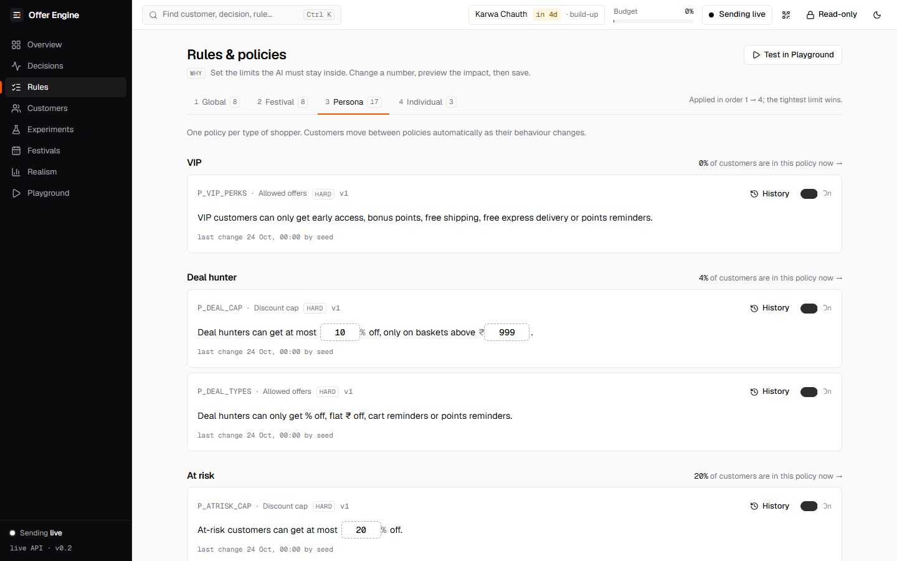 **Rules**: sentences with editable numbers, impact preview, versions |
| 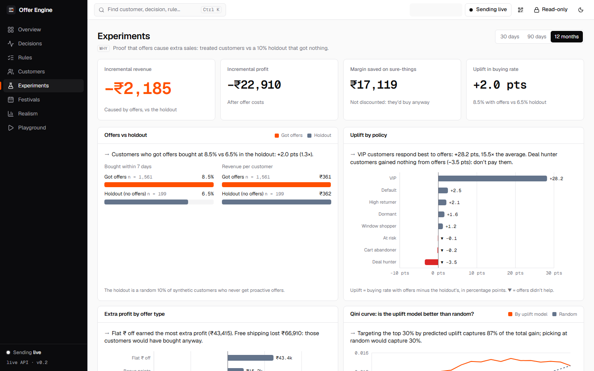 **Experiments**: each campaign vs its own control, ROI by offer type | 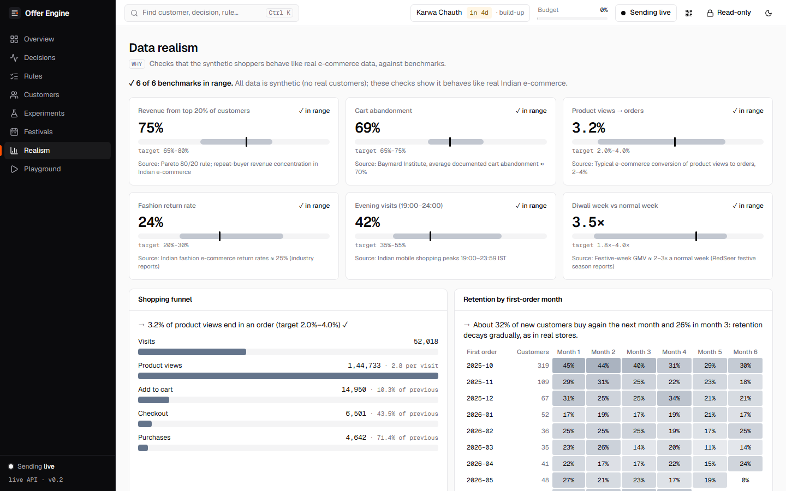 **Realism**: synthetic data checked against real-world benchmarks |
| 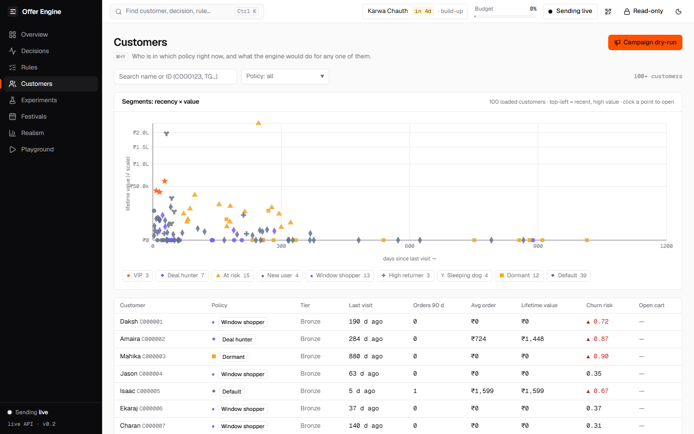 **Customers**: policies assigned live from scores | 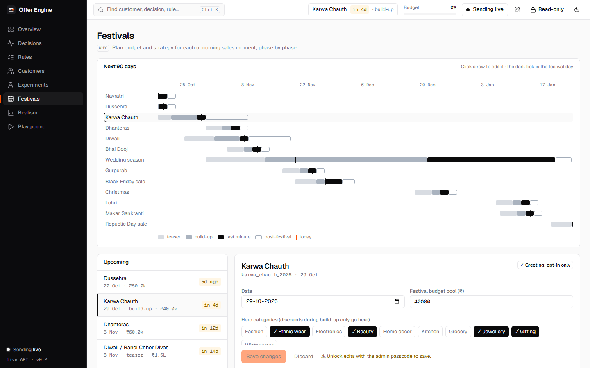 **Festivals**: phases, budgets, opt-in-only greetings |

Dark mode: [`02-overview-dark.png`](frontend/screenshots/02-overview-dark.png).

**Offer cards in Telegram** are drawn on the server in the same design system, sent as a photo with the explanation as the caption and the 4 buttons; if drawing ever fails, the text card goes out instead.

| | |
|---|---|
| 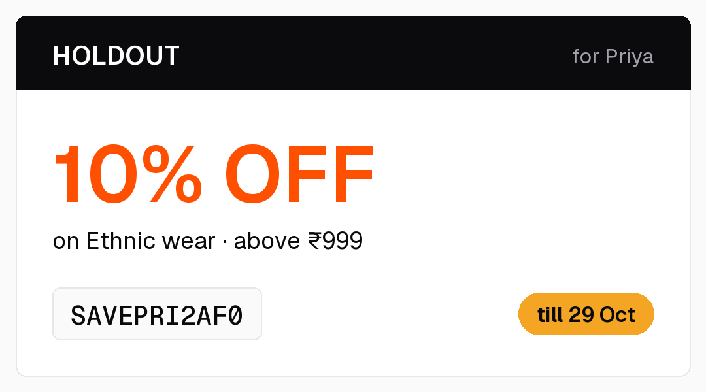 | 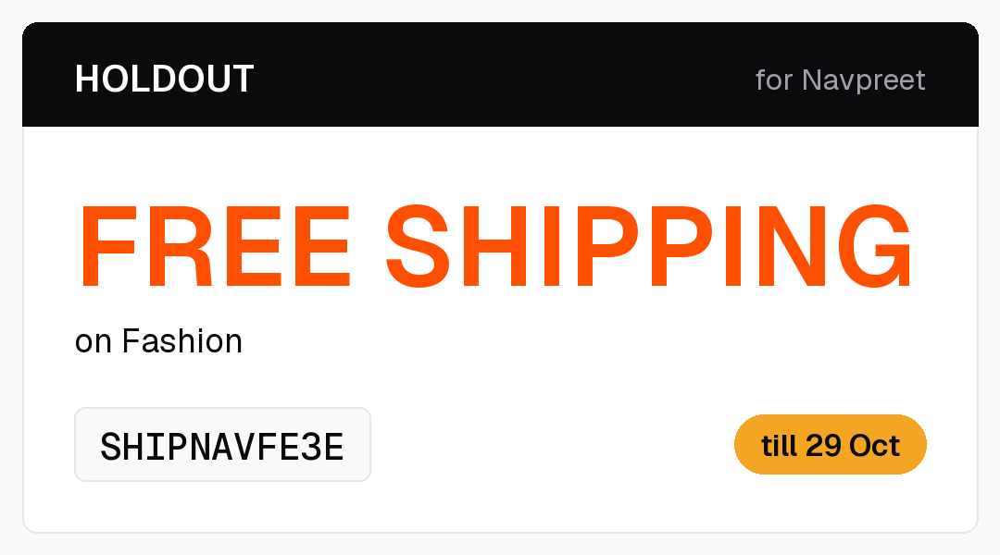 |

---

## How it decides

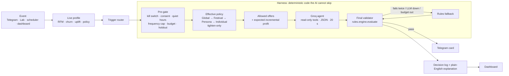

- **One function decides what is legal.** The pre-gate, the agent's `check_offer` tool and the final validator all call `rules.engine.evaluate()`, so they can't disagree. A property test pushes 10,000 random decisions through it, and nothing outside the limits is ever approved.
- **The AI is read-only.** Its tools can look up profiles, policies, offers and impact estimates, but cannot write or send anything. Customer text is wrapped as data and can never change rules or the agent's role.
- **It can never go silent.** If Groq times out, returns invalid JSON, hits a rate limit, fails validation twice or exceeds its daily token budget, the deterministic fallback picks the offer with the best expected incremental profit. A budget guard steps down from `gpt-oss-120b` to `gpt-oss-20b` at 80% of the daily budget and to rules-only at 100%.
- **Every decision is logged**, including blocked, held-out and "no offer" decisions, with why this customer, why this offer, the alternatives rejected, the rules applied and who decided.
- **Explanations never come from the AI's own words.** They are built from the candidates, numbers and rule results, so an invented reason can't reach a customer, a judge or the log. If the agent declines while an allowed offer pays for itself, the rules send the best one.
- **Tested:** 340 backend tests, including a hypothesis property test on `evaluate()`, LLM failure and retry cases, escaping of customer-typed text, and a test that runs every fallback message through the validator.

### Rules marketers can read
Rules are database rows, not `if persona == …` code. Each one renders as a sentence with editable numbers, for example *"Deal hunters can get at most **10%** off, only on baskets above **₹999**."*

| Layer | Examples |
|---|---|
| Global (hard limits) | margin guard, max 3 offers / 7 days, 48 h gap, quiet hours 21:00–09:00 IST, one active coupon, daily budget |
| Festival | Karwa Chauth / Dhanteras / Diwali phases with their own budgets and restricted promotions |
| Persona | 10 policies assigned live from scores: VIP (no % discounts), deal hunter, at-risk, new user, cart abandoner (nudge → free shipping → 5%), window shopper, high returner (points only), **sleeping dog (never disturb)**, dormant, default |
| Individual | `/stop`, `/pause`, 14-day "Not for me" category suppression |

A lower layer can only make limits **tighter**.

### Incrementality first
- Every synthetic customer has a hidden response type: *persuadable, sure-thing, lost cause* or *sleeping dog*. The engine never sees it; it has to infer it from behaviour.
- A **T-learner uplift model**, trained on past campaigns with a 10% control group, estimates how much an offer changes each customer's purchase probability. Only offers with positive expected **incremental** profit are allowed.
- **Zero-cost offers come first** (cart nudge, early access, 2× points, free-shipping thresholds). Real discounts are kept for customers they actually move.
- A **10% holdout** of synthetic customers gets "would have sent" decisions but no message. The Experiments page compares them with the treated group to report incremental revenue and margin saved.

### Culturally safe festival offers
- Festival greetings go **only** to customers who opted in during `/start`. Religion is never inferred from names.
- Greeting text comes from the `festivals` table, never from the LLM.
- Promotions restricted for a festival (for example meat or alcohol around certain festivals) are blocked by the validator.
- `/lab date 2026-11-06` time-travels the engine so any festival phase can be demoed on any day.

---

## What's in it

| Part | Highlights |
|---|---|
| **Telegram bot** | `/start` onboarding · `/simulate cart\|browse\|purchase\|inactive\|points_expiry\|festive\|payday` · `/why` · `/offers` · `/history` · `/profile` · `/pause` · `/resume` · `/stop` · buttons ✅ Claim · ⏰ Remind me tonight · 🙅 Not for me · ❓ Why this? · admin `/summary`, `/killswitch`, `/campaign run`, `/impersonate` |
| **Customer Lab** | A Telegram group where 10 synthetic customers (`C900001–C900010`), voiced by "Lab Shopper" bots, shop and react in character: `/lab here\|run\|who\|persona\|date\|reset` |
| **Scheduler** | Abandoned-cart nudges, a 09:05 flush of offers queued during quiet hours, points-expiry reminders, a 21:00 digest for admins |
| **Dashboard** | Overview (bento KPIs, live decision stream), Decisions (filters, drawer with Pipeline Lens and agent trace), Rules (sentence cards, impact preview, versions), Customers (segment scatter, simulate), Experiments, Festivals, Realism, Playground; ⌘K for the most common actions; kill switch always visible |
| **Synthetic data** | ~1,500 customers in production (5,000 locally), simulated day by day over 12 months. See [`docs/data-dictionary.md`](docs/data-dictionary.md) |

### Judging criteria → where to look

| Criterion | Evidence |
|---|---|
| **Core functionality** | Bot → harness → `evaluate()` → Telegram → log, live for any classmate. Agent with a guaranteed rules fallback. Every decision explained (`/why`, dashboard drawer) |
| **Data realism** | Day-by-day simulation with lognormal order values, Pareto revenue (top 20% ≈ 75% of revenue), ~70% cart abandonment, churn hazard, seasonality, festival and payday lifts, messy fields. The Realism page compares each against a benchmark band |
| **Usability for marketers** | Rules as sentences with inline numbers, impact preview before saving, versions and revert, one-click kill switch, ⌘K, a "Why this page exists" note on every page, campaign dry-run |
| **Design** | "Signal" system: cool monochrome, one orange accent for what matters, Geist / Geist Mono, Pipeline Lens, terminal-style live stream, no gradients or pie charts, status always shown with ✓/✗ or ▲▼ as well as colour |
| **Advanced functionality** | Tool-using LLM agent in a harness, T-learner uplift with a holdout, LLM token budget guard, top-5 agent batching for campaigns, multi-bot Customer Lab, demo time-travel |
| **Business relevance** | Incrementality-first: margin saved on sure-things, zero-cost offers first, budget pacing, festival calendar for the Karwa Chauth → Diwali season, consent and quiet hours |

---

## Run it yourself

**Requirements:** Python 3.11, Node 20+.

```bash
python -m venv .venv
```

```bash
.venv\Scripts\activate
```

```bash
pip install -e "backend[dev]"
```

```bash
python -m app.data.seed --customers 5000 --seed 42
```

```bash
uvicorn app.main:app --reload --app-dir backend
```

The API runs on http://localhost:8000. Without `TELEGRAM_BOT_TOKEN` the bot is disabled and everything else works; without `GROQ_API_KEY` every decision is made by the rules fallback.

Dashboard (http://localhost:5173; set `VITE_USE_MOCKS=1` to run without the backend):

```bash
cd frontend && npm i && npm run dev
```

Tests and lint:

```bash
pytest backend/tests -q && ruff check backend
```

```bash
cd frontend && npm run lint && npm run build
```

### Deploy
- **Backend:** Render free web service from [`render.yaml`](render.yaml) (Docker, `backend/Dockerfile`). The Telegram webhook registers itself on boot from `PUBLIC_BASE_URL`. cron-job.org pings `/health` every 10 minutes so the service doesn't sleep.
- **Database:** Neon Postgres (free tier). SQLite locally.
- **Dashboard:** Vercel, root directory `frontend`, framework Vite.

### Environment variables (names only; values live in `.env` or the host's settings)
| Group | Variables |
|---|---|
| Telegram | `TELEGRAM_BOT_TOKEN`, `TELEGRAM_WEBHOOK_SECRET`, `CUSTOMER_BOT_TOKENS`, `ADMIN_TELEGRAM_IDS`, `LAB_GROUP_CHAT_ID` (optional) |
| LLM | `GROQ_API_KEY`, `GROQ_MODEL_AGENT` (`openai/gpt-oss-120b`), `GROQ_MODEL_FAST` (`openai/gpt-oss-20b`), `LLM_DAILY_TOKENS_AGENT`, `LLM_DAILY_TOKENS_FAST`, `FORCE_LLM_FAIL` |
| App | `DATABASE_URL`, `ADMIN_PASSCODE`, `PUBLIC_BASE_URL`, `CORS_ORIGINS`, `TZ=Asia/Kolkata`, `DEMO_TIME_OVERRIDE` |
| Dashboard | `VITE_API_URL`, `VITE_USE_MOCKS` |

See [`.env.example`](.env.example). No secret is committed to this repository.

### Stack
FastAPI · SQLModel · Pydantic v2 · APScheduler · python-telegram-bot 21 · Groq · numpy / pandas / Faker / scikit-learn · pytest + hypothesis · ruff — React + Vite + TypeScript · Tailwind v4 · shadcn/ui · TanStack Query/Table · Recharts · cmdk.

---

## Repository map
```
backend/app/
  data/       synthetic generator, personas, festivals, seed CLI, onboarding
  scoring/    profiles, RFM, churn, uplift T-learner, impact, realism, experiments
  rules/      rule types (+ describe()), layered engine, evaluate(), seed rules, offers
  agent/      harness, Groq client, read-only tools, prompts, fallback, explainer, budget guard
  bot/        Telegram onboarding, /simulate, cards, buttons
  lab/        Customer Lab: 10 personas, Lab Shopper bots, /lab commands
  api/        REST API for the dashboard   scheduler/  proactive jobs
  ports.py    the only way modules call each other   contracts.py  shared Pydantic models
frontend/     React dashboard ("Signal" design system)
docs/         plan, contracts, session context files, progress log, detective traps
```

## How we built it: CLAUDE.md and parallel AI sessions
This project was built with Claude Code running as five parallel sessions, coordinated through files in the repo:
- [`CLAUDE.md`](CLAUDE.md): permanent rules loaded on every prompt (mission, non-negotiables such as "every decision goes through `evaluate()`", design system, ownership map).
- [`docs/claude-progressive.md`](docs/claude-progressive.md): what is true *right now* in the current phase; rewritten by the integrator before each phase.
- [`docs/contracts.md`](docs/contracts.md) + `backend/app/contracts.py`: shared models and interfaces, frozen per phase. Sessions call each other only through `app/ports.py`, which falls back to stubs until the real module exists, so all four could build in parallel.
- `docs/context/context-1..4.md`: one brief per session (A data & scoring, B rules & agent, C Telegram & Lab, D dashboard). A main "integrator" session merged them at gates, ran the integration smoke tests and deployed.
- [`docs/detective.md`](docs/detective.md): a list of traps (building a store, generic chatbots, pie charts, secrets in git, features after the freeze…) that every request is checked against first.
- [`docs/progress.md`](docs/progress.md) and [`docs/sessions.md`](docs/sessions.md): the append-only build log, the gate health log and contract change requests.

The human made every commit. Claude proposed small, tested checkpoints with exact commands.
