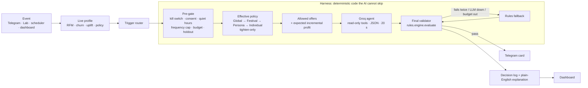

# Holdout

**Offers only where they change the outcome.** A personalised-offer engine that doesn't pay people who'd buy anyway.

**Telegram bot:** [@navpreet_offers_bot](https://t.me/navpreet_offers_bot) · **Dashboard:** https://offer-engine-nu.vercel.app · **API:** https://offer-engine-n4jx.onrender.com/health

Most discount engines send 20% off to everyone and call the sales it "drove" a win. But many of those customers would have bought anyway. That is margin thrown away. **Holdout** is an analytics and agentic decisioning platform for e-commerce marketers. For each customer and moment it decides **whether** to make an offer, **which** offer and **when**, and delivers it through a Telegram bot. Marketers set the limits as plain-English rules. An AI agent (Groq) chooses and personalises the offer inside those limits. **Every AI choice is re-checked by the same deterministic rule code before it is sent**, and a rules fallback takes over whenever the AI is slow, wrong or over budget. Uplift scores, a 10% holdout group and "margin saved" reporting show that the money went where it changed behaviour.

*Why "Holdout"?* A holdout is the group that deliberately gets nothing, so you can measure what an offer really changed. Building the whole engine around that idea is what makes it different.

> Built for the Punjab Jobs AI Bootcamp (J-PAL South Asia) hackathon. All customer data is **synthetic**; no real or scraped personal data is used.

## Try it yourself: scan and start


1. **Scan the QR** with your phone camera (or open [t.me/navpreet_offers_bot](https://t.me/navpreet_offers_bot)). The same QR is behind the **Telegram icon in the dashboard's top bar**.
2. Send **`/start`** and answer 3 taps: what you like to buy, how often you shop, deals or quality (plus an optional festival-greeting opt-in). A profile is built for you and a **welcome offer card** arrives.
3. Play the shopper with the commands below and watch the engine decide. Tap **❓ Why this?** on any card for the full reason.
4. From then on, offers also arrive **automatically**: a nudge 30 min after you leave a cart, a reminder before points expire, and a **personal pick** at 11:00 and 18:00 IST. Nothing is sent 21:00–09:00; those wait until morning.

| Command | What it does |
|---|---|
| `/start` | Join (or change your answers) and get a welcome offer |
| `/simulate` | Opens a button menu of shopper actions; or type one directly: |
| `/simulate cart` | You left an item in your cart → the engine decides an offer |
| `/simulate browse` | You browsed a category several times |
| `/simulate purchase` | You bought something → discounts are blocked for 48 h (try `/simulate cart` right after) |
| `/simulate inactive` | You haven't visited for a while → win-back logic |
| `/simulate points_expiry` | Your reward points are about to expire |
| `/simulate festival` | A festival is coming up (greeting only if you opted in) |
| `/simulate payday` | It's the 1st of the month, salaries just landed |
| `/simulate persona deal_hunter` | Switch to another shopper type (vip, deal_hunter, …) to see different rules apply |
| `/why` | Why you got (or didn't get) the last message |
| `/offers` | Your active coupons |
| `/history` | Your last 5 decisions, including blocked and "no offer" |
| `/profile` | What the engine knows about you, in plain words |
| `/pause` · `/resume` | No offers for a while (7 days, or `/pause 3`) · start again |
| `/stop` | Unsubscribe immediately |
| `/help` | All commands |

**Card buttons:** ✅ Claim · ⏰ Remind me tonight · 🙅 Not for me (mutes that category for 14 days) · ❓ Why this?

**Customer Lab group** (10 synthetic shoppers voiced by bots): `/lab@navpreet_offers_bot run 3` shows three personas getting three different answers. Admins also have `/summary`, `/killswitch on|off`, `/campaign run <policy>` and `/impersonate <customer>`.

### Results (live, last 12 months)
| | |
|---|---|
| **+₹91,760** | incremental revenue vs the holdout, each campaign compared with its own control group |
| **₹14,916** | margin saved by *not* discounting customers who'd have bought anyway |
| **about ₹1.7k** | incremental profit after coupon costs: small because the year includes one loss-making blanket campaign (the last 90 days alone: about ₹5.4k) |
| **ROI by offer type** | flat ₹ off pays back 1.9×, 2× points are almost free, while blanket free shipping **lost ₹24,320**: the customers who got it bought *less* than their control group (negative lift), not because shipping was expensive. That is the case for targeting |
| **~2 s** | per AI decision (gpt-oss-120b, one call); about 25 ms when the rules fallback decides |

These are measured against control groups, so they don't change when offers are sent; [Prove the numbers](#prove-the-numbers) shows how to recompute them from the raw data.

---

## Show it in 6 minutes

The same order as the demo video ([`docs/voiceover-script.md`](docs/voiceover-script.md)): the numbers first, then how they're made, then try it yourself.

| # | Where | Do this | What you'll see |
|---|---|---|---|
| 1 | Dashboard → **Overview** | Open https://offer-engine-nu.vercel.app | The orange hero **₹91,760** (extra sales offers caused), **₹14,916** margin saved, sent today, the live decision stream, the Automations card |
| 2 | Overview → proof | Explain one **campaign** (one offer to many customers) and its **control group** (a random 10% who get nothing). Then show [`generator.py:156`](backend/app/data/generator.py) and run the SQL in [Prove the numbers](#prove-the-numbers) on Neon | Six campaigns in code with `CONTROL_SHARE = 0.10`; the raw `campaign_history` rows recompute the same ₹91,760 |
| 3 | Overview → live stream | Click any line | The **Decision Pipeline Lens**: Pre-gate → Policy → Agent → Validator → Sent, each ✓/✗/↺, with the plain-English reason |
| 4 | **Customers**, **Realism** | Open one customer; glance at the benchmarks | ~1,500 synthetic customers plus 10 Lab customers plus real Telegram users; policies from behaviour; every realism benchmark ✓ |
| 5 | **Playground** | Cart abandoner → Run, then toggle **Force LLM failure** → Run | The AI's choice with every rule ✓, then the **rules fallback** deciding safely |
| 6 | Overview → **Automations** | Unlock with the admin passcode (🔒), then **Personal picks → ▶ Run now** | A **run report**: every Telegram and Lab customer, their top category, the offer or the reason for none, who decided, the cost. Lab picks appear in the Customer Lab group and the shopper bots react; real users get a DM; Sent today, Budget used and the margin card's "Today: ₹… kept · ₹… spent" update |
| 7 | **Try it yourself** | Telegram icon in the top bar → **QR**, or open [@navpreet_offers_bot](https://t.me/navpreet_offers_bot); `/start` → 3 taps → `/simulate cart` → **❓ Why this?** → `/simulate purchase` + `/simulate cart` | A welcome card; an offer card with value, expiry, coupon and 4 buttons; the full explanation; then a **block** by the 48-hour rule, with the reason. From then on, offers also arrive **automatically** (cart nudges, points reminders, personal picks at 11:00 and 18:00, never 21:00–09:00) |

Customer Lab group: `/lab@navpreet_offers_bot run 3` shows three personas getting three different answers, some with **no offer on purpose**.

### Prove the numbers
- **Campaign:** one offer sent to many customers at once, with its own coupon code. The synthetic year has six (Diwali 2025 `DIWALI15`, Black Friday `BF300`, Lohri `LOHRISHIP`, Holi `HOLI2X`, Summer sale `SUMMER10`, Independence Day `AZADI200`); five fall in the last 12 months.
- **Control group:** in every campaign a random 10% get nothing. Random means the only difference between the groups is the offer, so *(offer group's buy rate − control's buy rate) × customers who got it × typical basket* = sales the offer **caused**. The sum over campaigns is the hero number: **measured, not counted**.
- **Margin saved:** the control group also shows how many coupon users would have bought anyway; that share of the coupon cost is ₹14,916.
- **Honest loss:** Lohri's blanket free shipping went to 205 customers who bought *less* than their control group (−₹88,918 revenue, −₹24,320 profit; the shipping itself cost only ₹1,010). That is the case for targeting.
- **Why it doesn't move when you send offers:** real Telegram users are never held out, so live offers have no control group yet; they join the number only once a fair comparison exists. It is a rolling 12-month window: the next change is around 25 Nov 2026, when Black Friday 2025 leaves it.

Recompute it on Neon (SQL Editor, read-only):
```sql
WITH c AS (
  SELECT campaign_id,
         COUNT(*) FILTER (WHERE NOT is_control) AS treated,
         COUNT(*) FILTER (WHERE is_control)     AS control,
         AVG(converted::int) FILTER (WHERE NOT is_control) AS t,
         AVG(converted::int) FILTER (WHERE is_control)     AS k,
         SUM(revenue) FILTER (WHERE converted)::numeric
           / NULLIF(COUNT(*) FILTER (WHERE converted), 0)   AS basket
  FROM campaign_history
  WHERE sent_at >= now() - interval '365 days'
  GROUP BY campaign_id
)
SELECT campaign_id, treated, control, ROUND((t - k) * treated * basket) AS extra_revenue
FROM c WHERE control >= 20 ORDER BY campaign_id;
```

The spoken pitch and the scene-by-scene video script are in [`docs/voiceover-script.md`](docs/voiceover-script.md); a timed live walk-through with backup answers is in [`docs/demo-script.md`](docs/demo-script.md). Every feature is explained in [`docs/final.md`](docs/final.md), and the 2-page summary for the panel is [`docs/Holdout-summary.pdf`](docs/Holdout-summary.pdf). All documentation (user guide, architecture, API, operations) is indexed in [`docs/README.md`](docs/README.md).

### Screenshots (live data)
| | |
|---|---|
|  **Overview**: the one orange number is revenue offers actually caused, vs the holdout |  **Playground**: Pre-gate → Policy → Agent → Validator, every step explained |
|  **Decision drawer**: explanation, rule ✓/✗, agent tool calls, card preview |  **Rules**: sentences with editable numbers, impact preview, versions |
|  **Experiments**: each campaign vs its own control, ROI by offer type |  **Realism**: synthetic data checked against real-world benchmarks |
|  **Customers**: policies assigned live from scores |  **Festivals**: phases, budgets, opt-in-only greetings |

Dark mode: [`02-overview-dark.png`](frontend/screenshots/02-overview-dark.png).

**Offer cards in Telegram** are drawn on the server in the same design system, sent as a photo with the explanation as the caption and the 4 buttons; if drawing ever fails, the text card goes out instead.

| | |
|---|---|
|  |  |

---

## How it decides



- **One function decides what is legal.** The pre-gate, the agent's `check_offer` tool and the final validator all call `rules.engine.evaluate()`, so they can't disagree. A property test pushes 10,000 random decisions through it, and nothing outside the limits is ever approved.
- **The AI is read-only.** Its tools can look up profiles, policies, offers and impact estimates, but cannot write or send anything. Customer text is wrapped as data and can never change rules or the agent's role.
- **It can never go silent.** If Groq times out, returns invalid JSON, hits a rate limit, fails validation twice or exceeds its daily token budget, the deterministic fallback picks the offer with the best expected incremental profit. A budget guard steps down from `gpt-oss-120b` to `gpt-oss-20b` at 80% of the daily budget and to rules-only at 100%.
- **Every decision is logged**, including blocked, held-out and "no offer" decisions, with why this customer, why this offer, the alternatives rejected, the rules applied and who decided.
- **Explanations never come from the AI's own words.** They are built from the candidates, numbers and rule results, so an invented reason can't reach a customer, a judge or the log. If the agent declines while an allowed offer pays for itself, the rules send the best one.
- **Tested:** 369 backend tests, including a hypothesis property test on `evaluate()`, LLM failure and retry cases, escaping of customer-typed text, and a test that runs every fallback message through the validator.

### Rules marketers can read
Rules are database rows, not `if persona == …` code. Each one renders as a sentence with editable numbers, for example *"Deal hunters can get at most **10%** off, only on baskets above **₹999**."*

| Layer | Examples |
|---|---|
| Global (hard limits) | margin guard, max 3 offers / 7 days, 48 h gap, quiet hours 21:00–09:00 IST, one active coupon, daily budget |
| Festival | Karwa Chauth / Dhanteras / Diwali phases with their own budgets and restricted promotions |
| Persona | 10 policies assigned live from scores: VIP (no % discounts), deal hunter, at-risk, new user, cart abandoner (nudge → free shipping → 5%), window shopper, high returner (points only), **sleeping dog (never disturb)**, dormant, default |
| Individual | `/stop`, `/pause`, 14-day "Not for me" category suppression |

A lower layer can only make limits **tighter**.

### Incrementality first
- Every synthetic customer has a hidden response type: *persuadable, sure-thing, lost cause* or *sleeping dog*. The engine never sees it; it has to infer it from behaviour.
- A **T-learner uplift model**, trained on past campaigns with a 10% control group, estimates how much an offer changes each customer's purchase probability. Only offers with positive expected **incremental** profit are allowed.
- **Zero-cost offers come first** (cart nudge, early access, 2× points, free-shipping thresholds). Real discounts are kept for customers they actually move.
- A **10% holdout** of synthetic customers gets "would have sent" decisions but no message. The Experiments page compares them with the treated group to report incremental revenue and margin saved.

### Culturally safe festival offers
- Festival greetings go **only** to customers who opted in during `/start`. Religion is never inferred from names.
- Greeting text comes from the `festivals` table, never from the LLM.
- Promotions restricted for a festival (for example meat or alcohol around certain festivals) are blocked by the validator.
- `/lab date 2026-11-06` time-travels the engine so any festival phase can be demoed on any day.

---

## What's in it

| Part | Highlights |
|---|---|
| **Telegram bot** | `/start` onboarding · `/simulate cart\|browse\|purchase\|inactive\|points_expiry\|festival\|payday` · `/why` · `/offers` · `/history` · `/profile` · `/pause` · `/resume` · `/stop` · buttons ✅ Claim · ⏰ Remind me tonight · 🙅 Not for me · ❓ Why this? · admin `/summary`, `/killswitch`, `/campaign run`, `/impersonate` |
| **Customer Lab** | A Telegram group where 10 synthetic customers (`C900001–C900010`), voiced by "Lab Shopper" bots, shop and react in character: `/lab here\|run\|who\|persona\|date\|reset` |
| **Scheduler** | Abandoned-cart nudges (every 5 min), a 09:05 flush of offers queued during quiet hours, points-expiry reminders (10:00), **personal picks** for every Telegram and Lab customer from their own profile (11:00 and 18:00, or **Run now** with a per-customer run report), a 21:00 digest for admins |
| **Dashboard** | Overview (bento KPIs, live decision stream), Decisions (filters, drawer with Pipeline Lens and agent trace), Rules (sentence cards, impact preview, versions), Customers (segment scatter, simulate), Experiments, Festivals, Realism, Playground; ⌘K for the most common actions; kill switch always visible |
| **Synthetic data** | ~1,500 customers in production (5,000 locally), simulated day by day over 12 months. See [`docs/data-dictionary.md`](docs/data-dictionary.md) |

### Judging criteria → where to look

| Criterion | Evidence |
|---|---|
| **Core functionality** | Bot → harness → `evaluate()` → Telegram → log, live for any classmate. Agent with a guaranteed rules fallback. Every decision explained (`/why`, dashboard drawer) |
| **Data realism** | Day-by-day simulation with lognormal order values, Pareto revenue (top 20% ≈ 75% of revenue), ~70% cart abandonment, churn hazard, seasonality, festival and payday lifts, messy fields. The Realism page compares each against a benchmark band |
| **Usability for marketers** | Rules as sentences with inline numbers, impact preview before saving, versions and revert, one-click kill switch, ⌘K, a "Why this page exists" note on every page, campaign dry-run |
| **Design** | "Signal" system: cool monochrome, one orange accent for what matters, Geist / Geist Mono, Pipeline Lens, terminal-style live stream, no gradients or pie charts, status always shown with ✓/✗ or ▲▼ as well as colour |
| **Advanced functionality** | Tool-using LLM agent in a harness, T-learner uplift with a holdout, LLM token budget guard, top-5 agent batching for campaigns, multi-bot Customer Lab, demo time-travel |
| **Business relevance** | Incrementality-first: margin saved on sure-things, zero-cost offers first, budget pacing, festival calendar for the Karwa Chauth → Diwali season, consent and quiet hours |

---

## Run it yourself

**Requirements:** Python 3.11, Node 20+.

```bash
python -m venv .venv
```

```bash
.venv\Scripts\activate
```

```bash
pip install -e "backend[dev]"
```

```bash
python -m app.data.seed --customers 5000 --seed 42
```

```bash
uvicorn app.main:app --reload --app-dir backend
```

The API runs on http://localhost:8000. Without `TELEGRAM_BOT_TOKEN` the bot is disabled and everything else works; without `GROQ_API_KEY` every decision is made by the rules fallback.

Dashboard (http://localhost:5173; set `VITE_USE_MOCKS=1` to run without the backend):

```bash
cd frontend && npm i && npm run dev
```

Tests and lint:

```bash
pytest backend/tests -q && ruff check backend
```

```bash
cd frontend && npm run lint && npm run build
```

### Deploy
- **Backend:** Render free web service from [`render.yaml`](render.yaml) (Docker, `backend/Dockerfile`). The Telegram webhook registers itself on boot from `PUBLIC_BASE_URL`. cron-job.org pings `/health` every 10 minutes so the service doesn't sleep.
- **Database:** Neon Postgres (free tier). SQLite locally.
- **Dashboard:** Vercel, root directory `frontend`, framework Vite.

### Environment variables (names only; values live in `.env` or the host's settings)
| Group | Variables |
|---|---|
| Telegram | `TELEGRAM_BOT_TOKEN`, `TELEGRAM_WEBHOOK_SECRET`, `CUSTOMER_BOT_TOKENS`, `ADMIN_TELEGRAM_IDS`, `LAB_GROUP_CHAT_ID` (optional) |
| LLM | `GROQ_API_KEY`, `GROQ_MODEL_AGENT` (`openai/gpt-oss-120b`), `GROQ_MODEL_FAST` (`openai/gpt-oss-20b`), `LLM_DAILY_TOKENS_AGENT`, `LLM_DAILY_TOKENS_FAST`, `FORCE_LLM_FAIL` |
| App | `DATABASE_URL`, `ADMIN_PASSCODE`, `PUBLIC_BASE_URL`, `CORS_ORIGINS`, `TZ=Asia/Kolkata`, `DEMO_TIME_OVERRIDE` |
| Dashboard | `VITE_API_URL`, `VITE_USE_MOCKS` |

See [`.env.example`](.env.example). No secret is committed to this repository.

### Stack
FastAPI · SQLModel · Pydantic v2 · APScheduler · python-telegram-bot 21 · Groq · numpy / pandas / Faker / scikit-learn · pytest + hypothesis · ruff — React + Vite + TypeScript · Tailwind v4 · shadcn/ui · TanStack Query/Table · Recharts · cmdk.

---

## Repository map
```
backend/app/
  data/       synthetic generator, personas, festivals, seed CLI, onboarding
  scoring/    profiles, RFM, churn, uplift T-learner, impact, realism, experiments
  rules/      rule types (+ describe()), layered engine, evaluate(), seed rules, offers
  agent/      harness, Groq client, read-only tools, prompts, fallback, explainer, budget guard
  bot/        Telegram onboarding, /simulate, cards, buttons
  lab/        Customer Lab: 10 personas, Lab Shopper bots, /lab commands
  api/        REST API for the dashboard   scheduler/  proactive jobs
  ports.py    the only way modules call each other   contracts.py  shared Pydantic models
frontend/     React dashboard ("Signal" design system)
docs/         plan, contracts, session context files, progress log, detective traps
```

## How we built it: CLAUDE.md and parallel AI sessions
This project was built with Claude Code running as five parallel sessions, coordinated through files in the repo:
- [`CLAUDE.md`](CLAUDE.md): permanent rules loaded on every prompt (mission, non-negotiables such as "every decision goes through `evaluate()`", design system, ownership map).
- [`docs/claude-progressive.md`](docs/claude-progressive.md): what is true *right now* in the current phase; rewritten by the integrator before each phase.
- [`docs/contracts.md`](docs/contracts.md) + `backend/app/contracts.py`: shared models and interfaces, frozen per phase. Sessions call each other only through `app/ports.py`, which falls back to stubs until the real module exists, so all four could build in parallel.
- `docs/context/context-1..4.md`: one brief per session (A data & scoring, B rules & agent, C Telegram & Lab, D dashboard). A main "integrator" session merged them at gates, ran the integration smoke tests and deployed.
- [`docs/detective.md`](docs/detective.md): a list of traps (building a store, generic chatbots, pie charts, secrets in git, features after the freeze…) that every request is checked against first.
- [`docs/progress.md`](docs/progress.md) and [`docs/sessions.md`](docs/sessions.md): the append-only build log, the gate health log and contract change requests.

The human made every commit. Claude proposed small, tested checkpoints with exact commands.
