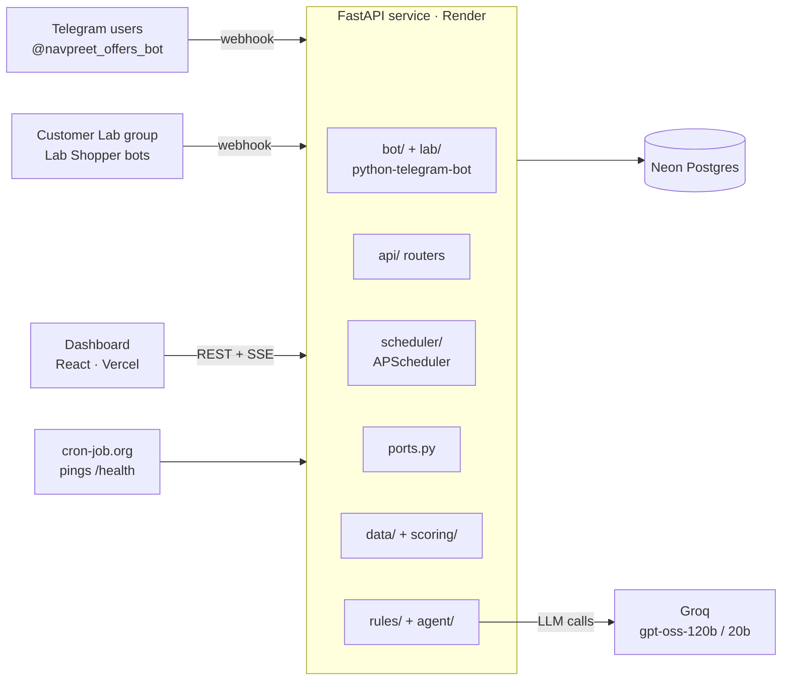
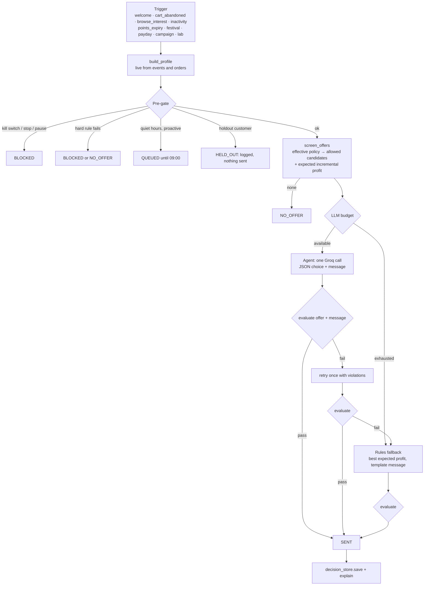

# Architecture

How Holdout is built: components, the decision lifecycle, data model and the design rules that keep it safe. For *what* each feature does, see [`final.md`](final.md); for the HTTP endpoints, see [`api.md`](api.md).

## 1. System overview

One FastAPI process runs everything: the REST API, the Telegram bot in webhook mode and the in-process scheduler. That keeps hosting on free tiers simple (trap T10: no microservices or queues).

## 2. Code layout and ownership

| Package | Responsibility | Built by |
|---|---|---|
| `app/data/` | synthetic generator, personas, product catalogue, festivals, seed CLI, `/start` onboarding history | Session A |
| `app/scoring/` | live profile (RFM, churn, uplift, policy), T-learner uplift, impact estimate, realism benchmarks, experiment statistics | Session A |
| `app/rules/` | rule types with `describe()`, layered engine, **`evaluate()`**, seed rules, offer catalogue, rule-impact preview | Session B |
| `app/agent/` | **harness**, Groq client, read-only tools, prompts, rules fallback, explainer, token budget guard, daily digest | Session B |
| `app/bot/` | Telegram onboarding, `/simulate`, commands, admin commands, card rendering (text + Pillow image), sending, resilience | Session C |
| `app/lab/` | Customer Lab registry (10 personas), activity scripts, round runner, `/lab` commands | Session C |
| `app/api/` | REST routers for the dashboard | Main |
| `app/scheduler/` | proactive jobs and their APScheduler runner | Main |
| `app/{main,config,db,models,contracts,ports,stubs,decision_store,runtime}.py` | app wiring, settings, database, shared models and interfaces | Main |
| `frontend/` | React dashboard | Session D |

### Ports: how modules call each other
Modules from different owners never import each other directly. They call **`app.ports`**, which resolves each function lazily: if the owner's module and function exist, the real one is used; otherwise a deterministic stub from `app.stubs` answers. This let four sessions build in parallel from day one, and `/health` reports every port as `real` or `stub`. In v1.0 all 25 ports are real.

Shared Pydantic models (`Customer`, `CustomerProfile`, `Context`, `Offer`, `Rule`, `Decision`, `Explanation`, …) live in `app/contracts.py` and are documented in [`contracts.md`](contracts.md) (contract version v1.1).

## 3. The decision lifecycle

Everything that can lead to a message goes through one function: `ports.decide(customer_id, trigger, trigger_meta, dry_run=False, now=None)`, implemented in `app/agent/harness.py`.

Details that matter:
- **Pre-gate first.** Kill switch, `/stop` and `/pause` are checked before anything else. Then `evaluate(profile, ctx, None, {})` runs every customer-level rule (frequency, gap, budget, post-purchase, sleeping dog …).
- **Quiet hours apply to proactive sends only.** `runtime.quiet_hours_apply(trigger, meta)` exempts replies the customer or an admin just asked for (`initiated_by` = `customer`/`admin`) and Lab rounds.
- **Holdout.** 10% of synthetic customers are held out: the decision is made and logged as `HELD_OUT`, but nothing is sent. Real Telegram users are never held out.
- **The agent** gets a single prompt with the profile, policy summary and pre-computed candidates (each with expected incremental profit), may call read-only tools (at most one `check_offer`), and must answer in strict JSON. Customer-typed text is wrapped as untrusted data.
- **One validator.** `rules.engine.evaluate(profile, ctx, offer_id, params, message)` checks every rule on the exact offer **and** message (length, banned phrases, competitor names, every number and date in the text matching the offer, greeting allowed only if opted in and exact). The agent's own `check_offer` tool calls the same function.
- **Safety nets.** A timeout, 429, invalid JSON, two failed validations or an exhausted token budget hands over to `agent/fallback.py`. If the agent returns "no offer" while an allowed candidate is expected to pay for itself, the rules send the best one.
- **Explanations** (`agent/explainer.py`) are deterministic: built from candidates, numbers and rule results, never from the LLM's text.
- **Logging.** `decision_store.save()` is the only writer of decisions; dry runs are never stored. Every status is logged: SENT, QUEUED, HELD_OUT, NO_OFFER, BLOCKED.

Batches (`ports.decide_batch`, used by campaign dry-runs and big Lab runs) score everyone with the rules first and send only the top 5 by expected profit through the agent (trap T26).

## 4. Rules engine

- Rules are rows in the `rules` table (seeded from `rules/seed_rules.py`, editable from the dashboard, versioned in `rule_versions`).
- Each rule has a **layer** (global, festival, persona, individual), one of 11 **types** (`margin_guard`, `discount_cap`, `frequency_cap`, `quiet_hours`, `budget`, `eligibility`, `exclusion`, `stacking`, `escalation_ladder`, `message`, `festival_restriction`), **params**, conditions, `hard`/`soft` severity and `enabled`.
- Every rule type implements `check(...)` and `describe()`. `describe()` produces the marketer-facing sentence shown in the dashboard, `/why` and the Lab.
- **Effective policy** merges layers in the order Global → Festival → Persona → Individual; a lower layer can only tighten limits.
- **Persona policies** are assigned live by `scoring.profile.assign_policy` from thresholds in `POLICY_THRESHOLDS`, in this order: high_returner → sleeping_dog → vip → cart_abandoner → dormant → at_risk → new_user → deal_hunter → window_shopper → default.
- Budget pacing: above 80% of the daily budget, discount caps shrink automatically.
- A hypothesis property test runs thousands of random decisions through `evaluate()` and asserts that nothing out of limits is approved.

## 5. Scoring

| Piece | Method |
|---|---|
| Profile | built on every call from the live database (≈6 ms p50 on SQLite): recency, frequency, value, category affinity, open cart, points, offers in 7 days, active coupon, suppressed categories |
| Churn risk | logistic regression (AUC ≈ 0.78) |
| Uplift | T-learner per offer type, trained on past campaigns with a 10% control; sanity-checked against the hidden response types |
| Expected incremental profit | uplift × typical basket × category margin − offer cost |
| Experiments | every number is a sum of (campaign × offer type) cells, each campaign vs its own control (avoids Simpson's paradox); small controls (< 20) are reported as unmeasured |
| Realism | benchmark statistics with target bands (Pareto share, cart abandonment, funnel, retention, seasonality, returns) |

## 6. Data model

| Table | Holds |
|---|---|
| `customers` | synthetic (`C…`), Lab (`C9…`) and Telegram (`TG…`) customers; persona, consent flags (`opted_out`, `paused_until`), festival opt-ins, holdout flag, suppressed categories, BIGINT Telegram chat id |
| `products` | synthetic catalogue with category and price |
| `events` | sessions, views, add-to-cart, purchases, offer claims and declines |
| `orders` | orders with value, discount, coupon, payment method, returned flag |
| `points_ledger` | points earned and their expiry |
| `campaign_history` | past campaigns with treatment/control assignment (training data for uplift) |
| `offers` | offer catalogue (type, params, cost model) |
| `rules`, `rule_versions` | live rules and their history |
| `decisions` | every decision with profile snapshot, context, policy, candidates, agent trace, validation, explanation, status, outcome, Telegram message id |
| `festivals` | festival calendar with phases, hero categories, greeting, restricted promotions, budgets |
| `settings` | runtime settings: kill switch, Lab group, LLM token usage, judging-time overrides |
| `customer_bots` | which Lab Shopper bot voices which Lab customer (keyed by `customer_id`) |

The column-level dictionary and the generation logic are in [`data-dictionary.md`](data-dictionary.md). Production uses Neon Postgres; local development uses SQLite. Telegram ids are BIGINT (detective T29), and `db.init_db()` applies small idempotent migrations at startup.

## 7. Telegram layer

- **Webhook mode in production:** `POST /telegram/webhook/{secret}` checks both the path secret and Telegram's `X-Telegram-Bot-Api-Secret-Token` header. Polling (`python -m app.bot --polling`) is only for local development with a separate dev bot.
- The bot calls `ports.decide` in a worker thread and renders the result: SENT offers as a Pillow-drawn PNG card (`bot/card_image.py`) with the text as caption and 4 buttons; everything else as text. Any image failure falls back to the text card.
- Resilience: retries with backoff on 429/5xx, 403 marks the customer unreachable, duplicate `update_id`s are ignored, per-user rate limit on `/simulate`.
- **Customer Lab:** Telegram bots can't message each other, so the backend runs everything. Each round, a Lab Shopper bot posts the persona's activity, the backend writes the matching event, decides (`trigger="lab"`), the Holdout bot posts the card, and the shopper reacts in character from a persona response model.

## 8. Scheduler

`app/scheduler/runner.py` runs an `AsyncIOScheduler` (Asia/Kolkata) inside the web process, started only when the bot is enabled:

| Job | When | What |
|---|---|---|
| `cart_abandonment` | every 5 min | Telegram customers with a cart 30 min – 6 h old and not yet nudged → `decide("cart_abandoned")` → deliver |
| `flush_quiet_queue` | 09:05 | re-decides QUEUED decisions from the last 24 h with the morning's rules and consent |
| `points_expiry` | 10:00 | points expiring within 3 days, at most one reminder per 3 days |
| `personal_picks` | 11:00, 18:00 | one profile-based pick for every Telegram customer (`campaign`, DM; quiet hours apply) and every Lab customer (`lab`, posted in the Lab group in the background, shoppers react); one `decide_batch`, so the agent only handles the top 5 |
| `daily_digest` | 21:00 | digest to `ADMIN_TELEGRAM_IDS` |

Jobs never DM synthetic customers (Lab picks go to the bots' group), and one failing job never stops the others. `GET /api/scheduler` shows the next runs; `POST /api/scheduler/run/{job}` (admin) runs one now.

## 9. LLM budget guard

`agent/budget.py` counts tokens per IST day in the `settings` table: the 120B model until 80% of `LLM_DAILY_TOKENS_AGENT`, then the 20B model until `LLM_DAILY_TOKENS_FAST` is used up, then rules only. `/health` shows the current usage and mode, and the dashboard shows a "degraded AI" chip when the AI isn't the 120B model.

## 10. Time

All code uses `app.config.now()` (Asia/Kolkata), never `datetime.now()`, so demo time-travel works: `DEMO_TIME_OVERRIDE`, `/lab date`, or the Playground's date field.

## 11. Frontend

React + Vite + TypeScript with Tailwind v4 and restyled shadcn/ui, TanStack Query for data, Recharts for charts and cmdk for the ⌘K palette. Each page is lazy-loaded (main chunk ≈ 290 kB). `VITE_API_URL` points at the API; `VITE_USE_MOCKS=1` switches to built-in mock data. The "Signal" design system (tokens in `CLAUDE.md §7`) keeps the UI monochrome with one orange accent, and status is never shown by colour alone.

## 12. Security and privacy

- All customer data is synthetic; Telegram users provide only a first name and three tap answers.
- Secrets live only in `.env` (gitignored) and host settings; `.env.example` lists names only. Logs never contain tokens (`httpx` logging is silenced because it prints the bot URL).
- Dashboard reads are public; every write needs the `X-Admin-Passcode` header. Bot admin commands are limited to `ADMIN_TELEGRAM_IDS`.
- The LLM's tools are read-only; only harness code writes to the database.
